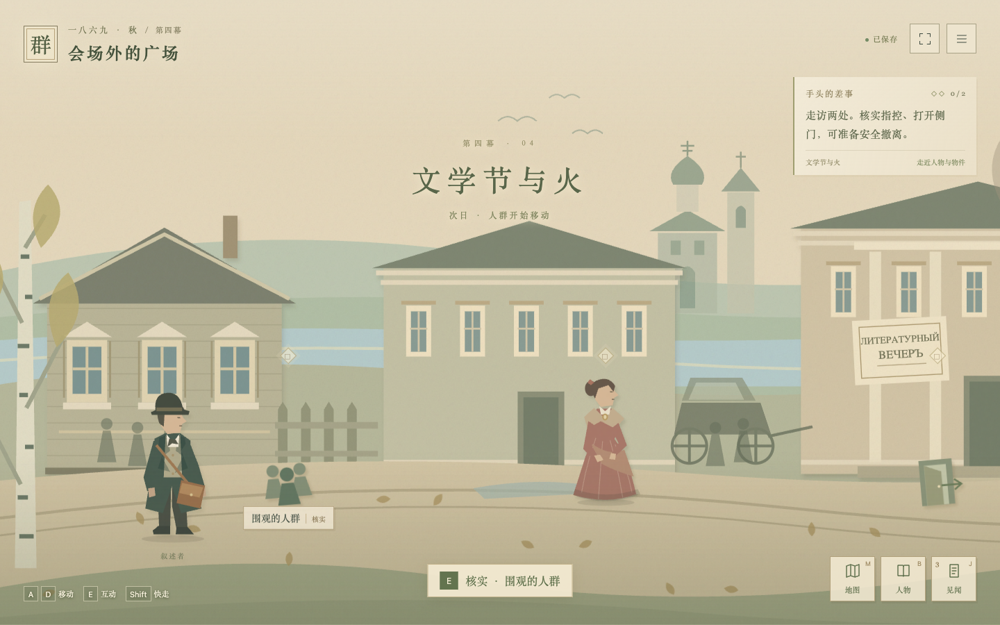

# 群魔 · 小城纸影

在线游玩：[game.v2ai.org/qunmo](https://game.v2ai.org/qunmo/)。发布配置为 `wrangler.jsonc`，发布记录见 `deploy/release-20261102.md`。

全屏横向探索的本地 2D 文学叙事游戏，采用浅色复古剪纸风。六幕场景、十一位人物、证据核对、有限走访与三个结局方向。对白、任务与可改变的局部命运为原创改编，游戏内标明与原著的区别。



原生 JavaScript ES 模块、CSS 与 SVG 实现，无第三方运行依赖。

美术时间采用 **1869 年秋，俄国省城**。这个年份是游戏改编的设定；原著背景为十九世纪六十年代后期。场景采用浅纸色、苔绿、灰蓝、旧木褐与少量酒红，以旧书页、信件、账簿与手稿组织界面。

十一位人物的剪纸造型区分长礼服、马甲、披肩、长裙和旧军装；贵族沙龙有钢琴、茶炊、瓷砖炉和烛台，普通住处保留木床、炉子和圣像。省城外景使用平缓河岸、木屋、灰泥宅邸、远处教堂、桦树、马车与落叶。以上为参考时代资料的原创演绎，并非具体房屋或服饰的逐件复原。游戏右上角年份按钮可打开“时代手记”和参考来源。

时代资料：

- [1860 年男性服装图版 · 罗德岛大学服装收藏](https://uritextilecollection.omeka.net/items/show/204)
- [1860 年代俄国女性肖像 · 美国国会图书馆](https://www.loc.gov/item/2021669208/)
- [1868—1870 年长裙 · John Bright 服装收藏](https://www.thejohnbrightcollection.co.uk/costume/dress-35/)
- [佩罗夫《梅季希饮茶》1862 · 普希金博物馆资料](https://rumyancev.pushkinmuseum.art/data/catalogue/canvas/rossiya/gtg5249.php)

## 游戏模式

标题画面进入游戏后，场景铺满浏览器窗口，世界横向展开，镜头跟随叙述者。探索时隐藏对话面板，只保留任务和随身物品；靠近人物时显示交谈提示。完成两次走访后，走到右侧出口触发幕间抉择。对话、手册和暂停菜单按需浮现，页面无需滚动。

右上角全屏按钮或 F 键可请求浏览器系统全屏；受限的内嵌浏览器会保留铺满窗口的显示。旧版存档使用相同格式，继续兼容。

## 在本机启动

需要 Node.js 18 或更高版本，不需要安装依赖。

```sh
git clone https://github.com/ai-graveyard/qunmo-game.git
cd qunmo-game
npm start
```

在浏览器打开终端显示的地址，默认为 http://127.0.0.1:4173 。服务器仅监听本机。端口被占用时会尝试后续端口。

macOS 也可以双击 `启动游戏.command`，会自动在默认浏览器打开游戏。启动后保持终端窗口打开，退出时按 Ctrl+C。

不要直接双击 `index.html`：浏览器需要通过本地服务器加载 ES 模块。

## 操作

- A / D、左右方向键：移动；Shift：快走。E：与附近人物或出口互动。
- 点击人物或物件：自动走近；点击空地：移动到该处。
- 1 / 2 / 3：选择当前对话选项；Space：确认调查或继续对话。
- B：人物手册；J：见闻录；M：地图；Esc：结束当前交谈或打开暂停菜单；F：系统全屏。
- 手机上使用点击操作或场景下方的移动按钮。

每幕两次走访。打开对话不计次数，确认选择或调查才消耗。已走访地点可以免费回看。两次走访后，前往场景右侧出口，按 E 或点击出口，进入幕间抉择并推进下一幕。阅读不倒计时，锁定选项显示所缺证据或行动。

进度保存在当前浏览器的 localStorage；隐私模式、清理站点数据或切换浏览器可能使存档不可用。在“阅读与设置”中可以导出或导入 JSON 存档、调整字号和重新开始。音乐默认关闭，由浏览器实时合成。

人物手册支持下载 2400×3300 SVG 一页人物身份表（含原著剧透，可浏览或打印）。见闻录支持下载 TXT。

## 验证

```sh
npm test
```

状态测试覆盖六幕推进、证据前置条件、重复走访、三种结局方向、局部命运分支与存档恢复。

```sh
npm run build
```

构建将 10 个浏览器文件复制到 `dist/`，可由静态服务器托管。Cloudflare 子路径发布步骤见 [发布记录](deploy/release-20261102.md#再次发布)。`output/`、`dist/`、浏览器检查产物与本机 Cloudflare 缓存不提交到仓库。GitHub Actions 在推送和拉取请求时执行测试与构建，不自动发布。

以下为 2026-11-02 发布时的浏览器验收记录；本次仓库整理重新执行了自动测试和静态构建。

全屏重构后，浏览器已按新流程完整通关六幕：实际行走到出口、触发抉择并推进剧情，最终获得 18 条行动记录及丽莎、沙托夫的介入分支；刷新后可以恢复最终记录。已验证系统全屏开关、镜头位移、暂停停止移动、数字键选择与空格继续，以及旧版 JSON 存档导入。

390×844 竖屏下，实际操作移动按钮、交谈与地图走访，检查镜头跟随到远处人物；对话框保持在视口内，页面无横向或纵向滚动。844×390 横屏触控模拟下，移动键、互动键与物品栏互不遮挡；320×568 小屏的对话和选项可操作。手机检查基于浏览器模拟，未作实体手机验收。

## 文件

- `data.mjs`：人物、证据、六幕剧情和选项。
- `engine.mjs`：纯函数状态转换、选择条件、结局与存档验证。
- `art.mjs`：关系图及美术模块入口。
- `period-art.mjs`：1869 年秋主题的原创 SVG 人物、场景、物件与衣饰说明。
- `app.mjs`：全屏游戏流程、镜头跟随、移动、对话、暂停、手册、导出、音频和存档。
- `style.css`：桌面及触屏排版、阅读字号和减少动态效果支持。
- `period.css`：人物图鉴、时代手记与纸本文书的视觉样式。
- `game.css`：全屏标题画面、游戏场景、HUD、镜头中的人物、对话浮层、暂停和触屏控制。
- `server.mjs`：无依赖本地静态服务器。
- `scripts/build.mjs`：按白名单生成静态发布包。
- `cloudflare/worker.mjs`：`/qunmo` 路径路由与静态资源映射。
- `wrangler.jsonc`：Cloudflare Workers 发布配置。

无外部字体、图片、账号或网络 API；运行时不需要互联网。原著参考：[Project Gutenberg · The Possessed / The Devils](https://www.gutenberg.org/ebooks/8117)。
